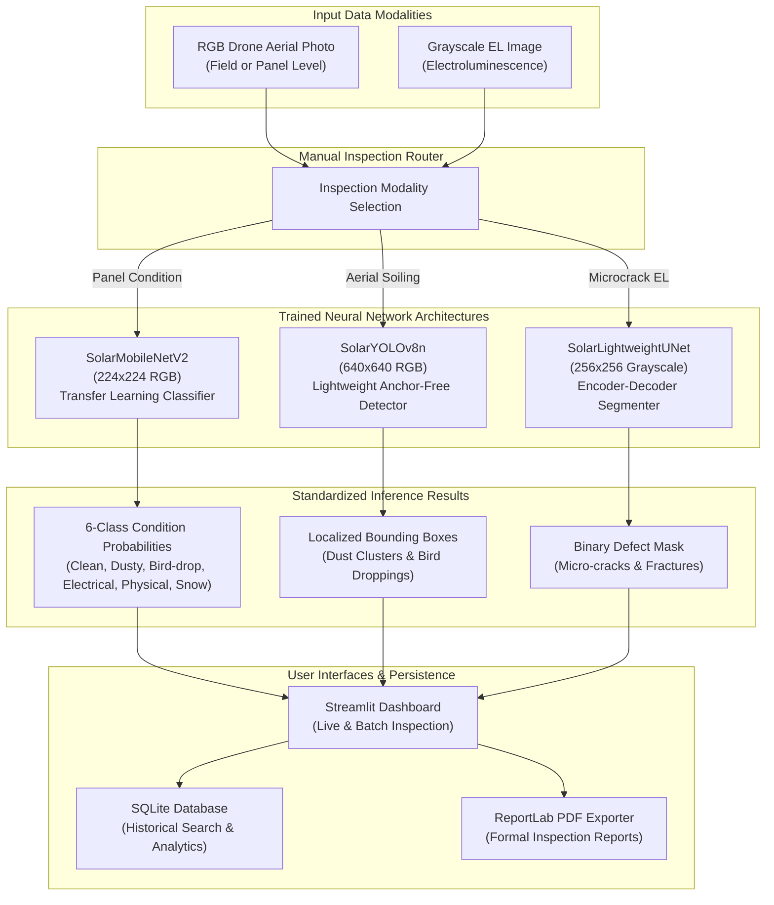

# SolarVision AI 🔆

**Automated Multi-Task Defect Inspection of Solar Panels from Drone & Electroluminescence Imagery**

[](https://www.python.org/)
[](https://pytorch.org/)
[](https://streamlit.io/)
[](LICENSE)
[]()
[]()

---

## 1. Project Overview & Objectives

Large-scale solar photovoltaic (PV) installations require periodic surface and internal structural inspection to prevent power derating, hot-spots, and fire hazards. However, manual physical inspection across megawatts of solar fields is labor-intensive, hazardous, and slow.

**SolarVision AI** is an academic computer vision and deep learning prototype designed to automate the screening and inspection of solar modules using two complementary imaging modalities:
1. **RGB Drone Photography:** Macro condition classification and surface soiling localization.
2. **Electroluminescence (EL) Imaging:** Micro-crack and internal silicon fracture segmentation.

### Core Objectives:
- Provide an integrated, lightweight multi-task vision pipeline across **Classification**, **Object Detection**, and **Semantic Segmentation**.
- Run efficiently on consumer laptop hardware (Intel Core Ultra CPU, 16 GB RAM) without requiring specialized NVIDIA CUDA accelerators.
- Deliver an interactive, beginner-friendly **Streamlit Dashboard** featuring real-time inference, sequential batch processing, persistent SQLite inspection logs, Plotly fleet analytics, and downloadable **ReportLab PDF reports**.

---

## 2. System Architecture & Workflow



---

## 3. The Three Inspection Modalities

| Modality | Task | Architecture | Checkpoint | Input Format | Output |
| :--- | :--- | :--- | :--- | :--- | :--- |
| **Panel Condition** | Image Classification | `SolarMobileNetV2` | `mobilenet_v2_best.pt` | $224 \times 224$ RGB | 6-class softmax probabilities & predicted class |
| **Aerial Soiling** | Object Detection | `SolarYOLOv8n` | `yolov8n_best.pt` | $640 \times 640$ RGB | Bounding boxes $[x_1, y_1, x_2, y_2]$, confidence & labels |
| **EL Microcracks** | Semantic Segmentation | `SolarLightweightUNet` | `unet_best.pt` | $256 \times 256$ Grayscale | Binary crack mask & active defect ratio (%) |

---

## 4. Benchmark Evaluation Results

All models were evaluated on designated, leak-free test partitions. Checkpoints are cached warm in RAM and run on CPU.

### 4.1 Classification: `SolarMobileNetV2`
- **Dataset:** Dataset A (Solar Panel Images, 6 classes, duplicate-grouped stratified split).
- **Test Set Accuracy:** **83.33%** (115/138 images; vs. 69.57% Custom CNN baseline, +13.76% improvement).
- **Macro F1 Score:** **83.54%** | **Weighted F1 Score:** **83.49%** (Macro Precision: 85.19%, Macro Recall: 82.50%).
- **Per-Class F1 / Recall:** Electrical-damage (90.32% F1 / 82.35% Recall), Snow-Covered (93.75% F1 / 88.24% Recall), Bird-drop (84.51% F1 / 85.71% Recall), Clean (81.97% F1 / 89.29% Recall), Dusty (77.97% F1 / 76.67% Recall), Physical-Damage (72.73% F1 / 72.73% Recall).
- **CPU Inference Latency:** ~92 ms per image.

### 4.2 Object Detection: `SolarYOLOv8n`
- **Dataset:** Dataset B (Aerial Soiling, Roboflow Universe).
- **Architecture:** Pure-PyTorch anchor-free detector with balanced focal objectness loss and clamped linear coordinate decoding.
- **Evaluation:** Test mAP@0.5: **8.57%** (Dust AP: 15.60%, bird-droppings AP: 1.55%).
- **CPU Inference Latency:** ~140 ms per image.

### 4.3 Segmentation: `SolarLightweightUNet`
- **Dataset:** Dataset C (MSPS Electroluminescence Silicon Cracks).
- **Architecture:** 4-stage encoder-decoder with skip connections and `BCEDiceLoss` ($pos\_weight=15.0$).
- **Optimal Decision Threshold:** $0.70$ (selected via validation threshold grid search).
- **Official 503-Image Test Split:**
  - **Global Dice (F1):** **73.54%**
  - **Global IoU (Jaccard):** **58.16%**
  - **Pixel Accuracy:** **99.97%**
- **CPU Inference Latency:** ~60 ms per image.

---

## 5. Dataset Attribution & Citations

1. **Dataset A — Solar Panel Defect Classification**
   - Source: Kaggle Solar Panel Images Dataset.
   - Classes: `Bird-drop`, `Clean`, `Dusty`, `Electrical-damage`, `Physical-Damage`, `Snow-Covered`.
   - License: CC BY 4.0.
2. **Dataset B — Aerial Solar Panel Soiling Detection**
   - Source: Roboflow Universe Aerial Soiling Dataset.
   - Annotations: YOLO format bounding boxes for `Dust` and `bird-droppings`.
   - License: CC BY 4.0.
3. **Dataset C — MSPS Multi-Scene Photovoltaic Electroluminescence Segmentation**
   - Source: Public PV Electroluminescence Benchmark Dataset.
   - Content: Grayscale EL cell crops and ground-truth binary crack segmentation masks.
   - License: Academic Research Use.

---

## 6. Installation & Quick Start

### 6.1 Hardware & OS Requirements
- **Operating System:** Windows 10/11, macOS, or Linux.
- **Python:** 3.11.x (Python 3.11.9 tested).
- **Hardware:** Intel Core Ultra / Core i5/i7/i9 or AMD Ryzen, 16 GB RAM recommended.
- **Storage:** ~2.5 GB free disk space (virtual environment + model weights).
- **GPU:** Optional. Pre-configured for CPU-safe execution out of the box.

### 6.2 Quick Start on Windows
We provide one-click automation scripts:

1. **Automated Setup:**
   Double-click `setup.bat` (or execute via PowerShell / CMD):
   ```cmd
   setup.bat
   ```
   This script creates `.venv`, upgrades pip, installs CPU PyTorch wheels, and installs all dependencies.

2. **Launch Dashboard:**
   Double-click `run.bat`:
   ```cmd
   run.bat
   ```
   The dashboard will automatically open in your default browser at `http://localhost:8501`.

### 6.3 Manual Setup
```bash
# 1. Clone repository and create virtual environment
git clone https://github.com/username/SolarVision-AI.git
cd SolarVision-AI
python -m venv .venv
.venv\Scripts\activate          # Windows
# source .venv/bin/activate     # Linux / macOS

# 2. Install PyTorch CPU build
pip install torch torchvision --index-url https://download.pytorch.org/whl/cpu

# 3. Install core dependencies
pip install -r requirements.txt
pip install -e .

# 4. Run automated test suite
pytest

# 5. Launch dashboard
streamlit run app/main.py
```

---

## 7. CLI Inference Runner

For automated server scripts or CI/CD testing, SolarVision AI provides a standalone Click CLI:

```bash
# Classification
python scripts/run_inference.py --image "data/raw/classification/Clean/Clean (10).JPG" --type classification

# Detection
python scripts/run_inference.py --image "data/raw/dust/aerial_soiling/test/images/ROI_102_jpg.rf.fa9f2d998fd0b9874bc2a3a58394e73e.jpg" --type detection --conf-threshold 0.15

# Segmentation
python scripts/run_inference.py --image "data/raw/microcracks/msps/test/images/First_101_20210705143317_5.png" --type segmentation --threshold 0.70
```
Annotated visual overlays and JSON summaries are saved directly to `reports/inference/`.

---

## 8. Dashboard Walkthrough

The Streamlit web application (`app/main.py`) provides three primary functional areas:

1. **🔍 Live Panel Inspection:**
   - Single-image drag-and-drop file upload (`.jpg`, `.jpeg`, `.png`).
   - Quick-demo preset dropdown to test representative samples immediately.
   - Side-by-side comparison of original and annotated result images.
   - Interactive Plotly probability charts and detection bounding box tables.
   - **"Save to History"** button and one-click **"Export PDF Report"** generator.

2. **📁 Sequential Batch Inspection:**
   - Process multiple drone survey images sequentially to control RAM usage.
   - Real-time progress bar with per-image status and latency metrics.
   - Failure-tolerant processing (corrupt files do not abort the remaining queue).
   - Instant CSV export and image gallery previews.

3. **📊 History & Fleet Analytics:**
   - Persistent inspection logging backed by SQLite (`data/inspections.db`).
   - Fleet-wide KPI metrics: Total inspections, defect rate, average latency.
   - Plotly analytics: Clean vs. Defect donut charts, modality volume breakdowns, and daily time trends.
   - Search by image filename or operator notes with modality and status filters.
   - Individual record detail view with full JSON payload and historical PDF report re-generation.

---

## 9. Academic Disclaimer & Limitations

> [!WARNING]
> **Academic Prototype Notice:** SolarVision AI is an educational and research prototype. Automated deep learning predictions (classification tags, bounding boxes, and segmentation masks) are indicative screening aids only. They must not be relied upon as the sole basis for commercial solar farm maintenance, insurance claims, or module warranty decisions without secondary on-site verification by certified photovoltaic engineers.

### Known Limitations:
- **Small-Object Soiling Detection:** In aerial drone captures, tiny dust clusters often span only a few pixels ($<10\times10$), where detector precision is naturally limited (mAP@0.5: 8.57%).
- **Lighting & View Angle Sensitivity:** High solar glare or extreme off-nadir camera pitch can reduce classification accuracy.
- **Grayscale EL Imaging Requirement:** Silicon microcrack segmentation requires specialized electroluminescence camera hardware and dark-box / nighttime excitation conditions.

---

## 10. Project Structure

```
SolarVision-AI/
├── app/                        # Streamlit Dashboard UI
│   ├── main.py                 # Multi-page coordinator & sidebar navigation
│   ├── components/             # Themes, custom CSS & Plotly chart generators
│   └── views/                  # Inspection, Batch, and History view modules
├── checkpoints/                # Trained PyTorch model weights (best checkpoints)
│   ├── classification/         # mobilenet_v2_best.pt
│   ├── detection/              # yolov8n_best.pt
│   └── segmentation/           # unet_best.pt
├── configs/                    # YAML configuration files
├── data/                       # Raw & processed datasets (not committed to git)
├── docs/                       # Project architecture & development plan
├── reports/                    # Output figures, inference results & PDF reports
├── scripts/                    # CLI scripts (preprocessing, inference, training)
├── src/                        # Core library code
│   ├── data/                   # DataLoaders, split manifests & augmentations
│   ├── database/               # SQLite schema & InspectionDatabaseManager
│   ├── evaluation/             # Evaluation metrics & visualization utilities
│   ├── inference/              # Unified pipeline, types & visualizer
│   ├── models/                 # PyTorch architectures (MobileNetV2, YOLOv8n, U-Net)
│   ├── training/               # CPU trainers, callbacks & early stopping
│   └── utils/                  # ReportLab PDF generator, config & model utils
├── tests/                      # Automated test suite (100 tests, 94% coverage)
│   ├── unit/                   # Unit tests mirroring src/
│   └── integration/            # Multi-modal inference & app integration tests
├── pyproject.toml              # Build & packaging configuration
├── requirements.txt            # Pinned dependency requirements
├── setup.bat                   # Automated Windows setup script
└── run.bat                     # One-click dashboard launcher
```

---

## 11. License

This project is licensed under the MIT License — see the [LICENSE](LICENSE) file for details.
